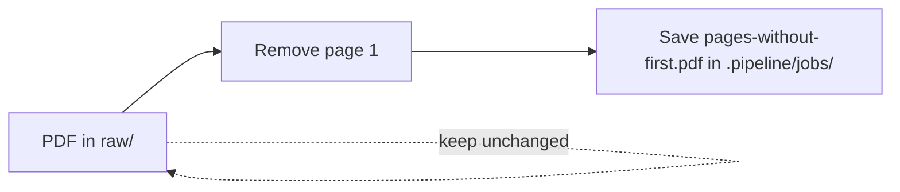

# Pipeline flow

This testing branch prepares PDFs only. Later pipeline stages are planned.

For `raw/signal/318/1.pdf`, the only job artifact is `.pipeline/jobs/signal/318/1/pages-without-first.pdf`. No page images, student views, extraction, or CSV files are produced on this branch.
