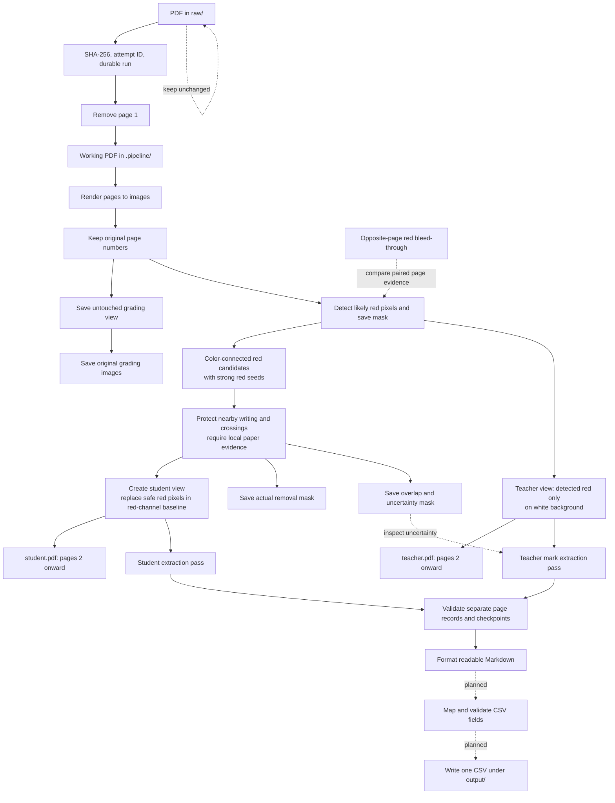

# Pipeline flow

Page removal, rendering, red-ink evidence, conservative student views, isolated page OCR, and separate/combined Markdown are implemented. Question mapping and CSV export remain planned.



The student pass receives only `student-view/`; the teacher pass receives only `teacher-view/`. Each page/pass is a separate Codex invocation using ChatGPT login, JSON schema validation, and an isolated workspace. Untouched `grading-view/` remains local evidence and is not attached to either OCR pass. Successful page records are checkpointed. After both passes finish, Markdown is published as `student.md`, `teacher.md`, and `ocr.md` with separate sections; no uncertain cross-pass question matching is inferred. Mapping to the fixed CSV format remains planned. For `raw/signal/318/1.pdf`, preprocessing is in `.pipeline/jobs/signal/318/1/`, OCR in `.pipeline/ocr/signal/318/1/`, and durable run history in `.pipeline/runs/<source-path-hash>/`.

Student views can retain uncertain teacher marks, especially at crossings. The masks are evidence for future exception handling, not proof that extraction inputs are free of grading information. Paired-page bleed-through comparison remains planned. See [red-mark removal](red-mark-removal.md).

The red-only teacher view and `teacher.pdf` are inspectable derivatives. Removing non-red context can make question association unclear; preserve null labels and request review instead of guessing. Neither PDF bundle includes the identity page or copied original text/metadata. PDF page labels and bookmarks retain original source page numbers. SHA-256 detects changed source content, and cached successes require current input/configuration signatures. See the README for Docker commands and result locations.

Example Markdown record for a question:

```md
## Question 1

### Student answer
x + 5 = 10
x = 10 - 5
x = 5

### Teacher mark
Raw mark: check symbol beside “x = 5”
Score: unclear
```
