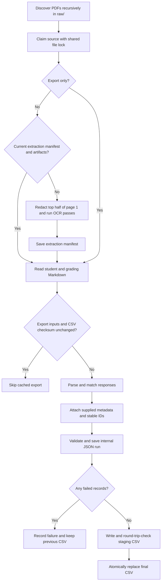

# Pipeline flow

The normal worker prepares, extracts, validates, and exports each PDF. The
export-only command starts from existing Markdown and never invokes Codex.

For `raw/signal/318/1.pdf`:

- `.pipeline/jobs/signal/318/1/` holds the prepared PDF, separate OCR responses,
  and combined `ocr.md`. Rendering uses temporary workspaces.
- `.pipeline/dataset/` holds internal JSON runs with provenance and review issues.
- `.pipeline/claims/` holds shared locks, extraction/export manifests, and failures.
- `output/signal/318/1.csv` holds the 36-column dataset. Review status and raw
  teacher records remain in internal JSON, outside the CSV schema.

The source stays unchanged and the top half of page 1 is permanently redacted in prepared content.
`needs_review` rows are exported; `failed` records block publication. The student
OCR pass currently still receives graded images, so the intended input-isolation
requirement is not yet satisfied. See [verification](pipeline-verification.md)
for what has been checked and what remains unverified.
