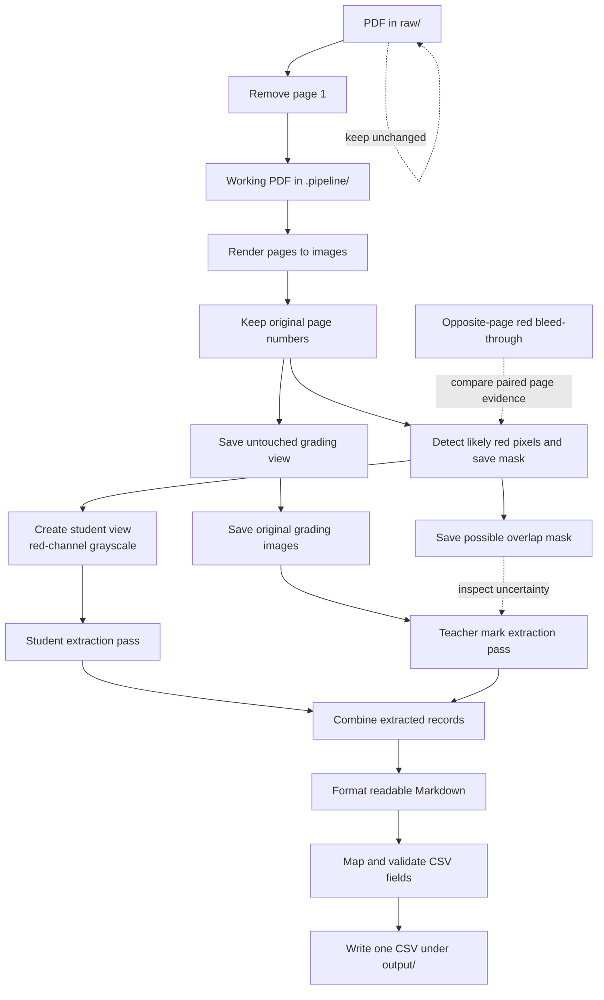

# Pipeline flow

The page-removal and rendering stage is implemented. The remaining steps are planned.



The extraction passes use separate inputs: the student pass receives only the student view, while the grading pass receives the untouched grading view. Their results can be combined into a readable Markdown record, then mapped to the fixed CSV format. Keep the untouched page renders as evidence and flag uncertain marks rather than guessing. Each PDF's inspectable working files are grouped by its path under `raw/`; for example, `raw/signal/318/1.pdf` uses `.pipeline/jobs/signal/318/1/`.

Example Markdown record for a question:

```md
## Question 1

### Student answer
x + 5 = 10
x = 10 - 5
x = 5

### Teacher mark
Raw mark: check symbol beside “x = 5”
Score: unclear
```
